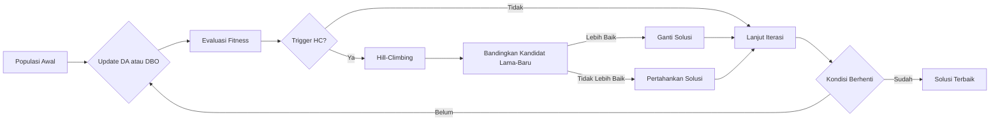

# Hybrid Hill-Climbing
## dengan Dragonfly Algorithm & Dung Beetle Optimization

<div class="mt-10 flex justify-center gap-4">
  <div class="px-5 py-3 rounded-xl bg-sky-500/15 text-sky-700 font-semibold">DA</div>
  <div class="text-3xl opacity-50">+</div>
  <div class="px-5 py-3 rounded-xl bg-amber-500/15 text-amber-700 font-semibold">Hill-Climbing</div>
  <div class="text-3xl opacity-50">+</div>
  <div class="px-5 py-3 rounded-xl bg-violet-500/15 text-violet-700 font-semibold">DBO</div>
</div>

**Arsitektur, metodologi eksperimen, dan demonstrasi interaktif**

---
layout: two-cols
class: px-10
---

# Cerita Presentasi

<div class="mt-6 space-y-4">
  <div class="p-4 rounded-xl border border-blue-300/40 bg-blue-500/5">
    <div class="text-sm font-bold text-blue-500">01</div>
    <strong>Masalah</strong><br/>Eksplorasi dan eksploitasi belum seimbang
  </div>
  <div class="p-4 rounded-xl border border-violet-300/40 bg-violet-500/5">
    <div class="text-sm font-bold text-violet-500">02</div>
    <strong>Solusi</strong><br/>Gunakan HC sebagai pencari optimum lokal
  </div>
  <div class="p-4 rounded-xl border border-amber-300/40 bg-amber-500/5">
    <div class="text-sm font-bold text-amber-600">03</div>
    <strong>Validasi</strong><br/>Bandingkan baseline dan versi hibrid
  </div>
</div>

::right::

<div class="h-full flex flex-col justify-center pl-8">

### Pertanyaan penelitian

> Seberapa besar peningkatan akurasi dan stabilitas ketika Hill-Climbing ditambahkan pada algoritma metaheuristik?

<div class="mt-10 text-sm opacity-70">
Fokus eksperimen: fungsi Rastrigin 2D<br/>
Tujuan: meminimalkan fungsi
</div>

</div>

---
layout: section
---

# 1. Mengapa Perlu Hybrid?

---
layout: two-cols
---

# Dragonfly Algorithm

<div class="mt-8 p-6 rounded-2xl border border-sky-300/50 bg-sky-500/5">

### Kekuatan
- Eksplorasi global
- Pergerakan berbasis swarm
- Sesuai untuk ruang pencarian luas

### Risiko
- Eksploitasi akhir dapat kurang presisi
- Konvergensi dapat lambat
- Hasil dipengaruhi parameter swarm

</div>

::right::

# Dung Beetle Optimization

<div class="mt-8 p-6 rounded-2xl border border-violet-300/50 bg-violet-500/5">

### Kekuatan
- Konvergensi cepat
- Beberapa perilaku pencarian
- Cocok untuk pencarian intensif

### Risiko
- Premature convergence
- Mudah stagnan pada fungsi multimodal
- Keragaman populasi dapat menurun

</div>

---

# Masalah yang Hendak Diselesaikan

<div class="grid grid-cols-3 gap-5 mt-10 text-center">
  <div class="p-6 rounded-2xl bg-slate-100 dark:bg-slate-800">
    <carbon-search class="text-4xl text-sky-500 mb-3"/>
    <strong>Eksplorasi</strong>
    <div class="text-sm mt-2 opacity-70">Menemukan wilayah yang menjanjikan</div>
  </div>
  <div class="p-6 rounded-2xl bg-slate-100 dark:bg-slate-800">
    <carbon-center-circle class="text-4xl text-amber-500 mb-3"/>
    <strong>Eksploitasi</strong>
    <div class="text-sm mt-2 opacity-70">Memperhalus solusi terbaik</div>
  </div>
  <div class="p-6 rounded-2xl bg-slate-100 dark:bg-slate-800">
    <carbon-scale class="text-4xl text-violet-500 mb-3"/>
    <strong>Keseimbangan</strong>
    <div class="text-sm mt-2 opacity-70">Tepat dan tidak terjebak lokal</div>
  </div>
</div>

<div class="mt-10 p-5 text-center rounded-xl border-l-4 border-amber-500 bg-amber-500/10 text-xl">
<strong>Ide kunci:</strong> metaheuristik mencari wilayah, HC memperhalus titik terbaik.
</div>

---

# Pembagian Peran

| Komponen | Peran | Waktu aktif |
|---|---|---|
| **DA / DBO** | Explorer global | Setiap iterasi |
| **Hill-Climbing** | Exploiter lokal | Setiap interval atau saat stagnan |
| **Fitness evaluator** | Mengukur kualitas | Setiap kandidat |
| **Benchmark** | Menguji efektivitas | Banyak seed percobaan |

<div class="mt-8 grid grid-cols-2 gap-6">
  <div class="p-4 rounded-xl bg-sky-500/10">
    <strong>HC-DA</strong><br/><span class="text-sm">HC dijalankan pada kandidat terisolasi atau berkumpul dalam cluster.</span>
  </div>
  <div class="p-4 rounded-xl bg-violet-500/10">
    <strong>HC-DBO</strong><br/><span class="text-sm">HC dijalankan pada solusi individu yang stagnan.</span>
  </div>
</div>

---
layout: section
---

# 2. Arsitektur Hybrid

---

# Alur Umum



---

# Mekanisme Integrasi

<div class="grid grid-cols-2 gap-8 mt-8">
  <div class="p-6 rounded-2xl border-t-4 border-sky-500 bg-sky-500/5">
    <div class="text-3xl mb-3">1</div>
    <h3>HC-DA: Berbasis Radius</h3>
    <p>HC diterapkan pada individu yang memiliki tetangga dalam radius tertentu.</p>
  </div>
  <div class="p-6 rounded-2xl border-t-4 border-violet-500 bg-violet-500/5">
    <div class="text-3xl mb-3">2</div>
    <h3>HC-DBO: Berbasis Stagnasi</h3>
    <p>Jika individu tidak membaik selama beberapa iterasi, jalankan pencarian lokal.</p>
  </div>
</div>

<div class="mt-8 p-5 rounded-xl bg-amber-500/10 border border-amber-300/40">
  <strong>Prinsip umum:</strong> HC tidak menggantikan eksplorasi global; HC hanya memperbaiki kandidat yang sudah menjanjikan.
</div>

---
layout: section
---

# 3. Metodologi

---

# Desain Eksperimen

| Konfigurasi | Perbandingan |
|---|---|
| Fungsi: **Rastrigin 2D** | DA |
| Domain: **[-5.12, 5.12]** | HC-DA |
| Populasi & iterasi dapat diatur | DBO |
| Pengulangan menggunakan beberapa seed | HC-DBO |

<div class="mt-8 p-5 rounded-xl border border-slate-300/50">
<strong>Ukuran keberhasilan:</strong> fitness terbaik, rata-rata, stabilitas antar-seed, dan waktu eksekusi.
</div>

<div class="mt-6 text-sm opacity-70">
Catatan: implementasi demo adalah implementasi ringkas untuk visualisasi, bukan replikasi penuh semua persamaan DA/DBO dari publikasi.
</div>

---
layout: section
---

# 4. Implementasi Singkat

---

# Hill-Climbing

```python
def hill_climbing(current, objective, step=0.05, max_iter=20):
    for _ in range(max_iter):
        candidate = current + np.random.uniform(-step, step, current.shape)

        if objective(candidate) < objective(current):
            current = candidate

    return current
```

<div class="mt-6 grid grid-cols-3 gap-4 text-center">
  <div class="p-4 bg-sky-500/10 rounded-xl">Buat tetangga</div>
  <div class="p-4 bg-amber-500/10 rounded-xl">Bandingkan fitness</div>
  <div class="p-4 bg-violet-500/10 rounded-xl">Terima bila lebih baik</div>
</div>

---

# Integrasi ke Loop Optimasi

```python
for iteration in range(max_iterations):
    population = update_metaheuristic(population)

    if should_run_hill_climbing(iteration, population):
        candidates = select_candidates(population)

        for i in candidates:
            population[i] = hill_climbing(
                population[i],
                objective,
                step=0.05
            )

best = population[np.argmin([objective(p) for p in population])]
```

---
layout: default
---

# Demo Interaktif

<iframe src="./hc-demo.html" style="width:100%; height:440px; border:1px solid rgba(148,163,184,.45); border-radius:14px;"></iframe>

---
layout: section
---

# 5. Cara Membaca Hasil

---

# Evaluasi yang Fair

<div class="grid grid-cols-2 gap-8 mt-8">
  <div class="p-6 rounded-xl border border-emerald-300/50 bg-emerald-500/5">
    <h3>Pastikan sama</h3>
    <ul>
      <li>Jumlah populasi</li>
      <li>Jumlah iterasi</li>
      <li>Fungsi objektif</li>
      <li>Seed acak</li>
      <li>Jumlah percobaan</li>
    </ul>
  </div>
  <div class="p-6 rounded-xl border border-rose-300/50 bg-rose-500/5">
    <h3>Hindari kesimpulan</h3>
    <ul>
      <li>Dari satu run</li>
      <li>Tanpa standar deviasi</li>
      <li>Dari demo visual saja</li>
      <li>Tanpa baseline</li>
    </ul>
  </div>
</div>

---

# Interpretasi Benchmark

| Kondisi | Interpretasi |
|---|---|
| HC turun searah baseline | Integrasi lokal membantu |
| Rata-rata HC lebih stabil | Variasi antar seed berkurang |
| Waktu meningkat tetapi akurasi tidak | Trigger terlalu agresif |
| Hasil tidak berbeda | HC atau trigger perlu disetel |

<div class="mt-10 p-5 text-center rounded-xl bg-sky-500/10">
  <strong>Pertanyaan utama:</strong> apakah tambahan HC memberikan peningkatan yang konsisten?
</div>

---
layout: section
---

# 6. Kesimpulan

---

# Kesimpulan

<div class="grid grid-cols-3 gap-5 mt-10 text-center">
  <div class="p-6 rounded-2xl bg-sky-500/10">
    <carbon-direction-fork class="text-4xl mb-4"/>
    <strong>DA/DBO</strong>
    <div class="mt-2 text-sm">Memilih wilayah pencarian</div>
  </div>
  <div class="p-6 rounded-2xl bg-amber-500/10">
    <carbon-fit-to-screen class="text-4xl mb-4"/>
    <strong>Hill-Climbing</strong>
    <div class="mt-2 text-sm">Memperhalus kandidat</div>
  </div>
  <div class="p-6 rounded-2xl bg-violet-500/10">
    <carbon-result class="text-4xl mb-4"/>
    <strong>Validasi</strong>
    <div class="mt-2 text-sm">Bandingkan melalui eksperimen</div>
  </div>
</div>

<div class="mt-10 p-6 rounded-2xl border-l-4 border-emerald-500 bg-emerald-500/10 text-xl">
Hill-Climbing dapat memperbaiki presisi akhir, tetapi nilainya bergantung pada <strong>trigger, step size, dan biaya komputasi</strong>.
</div>

---
layout: center
---

# Rekomendasi Penelitian

1. Gunakan **rayon neighbor** dan **stagnasi** sebagai dua strategi trigger.
2. Uji beberapa fungsi selain Rastrigin.
3. Laporkan rata-rata, standar deviasi, dan confidence interval.
4. Tambahkan batas waktu evaluasi agar biaya HC diukur adil.
5. Gunakan jumlah seed yang cukup untuk mendukung kesimpulan.

---
layout: center
class: text-center
---

# Terima Kasih

### Pertanyaan & Diskusi
